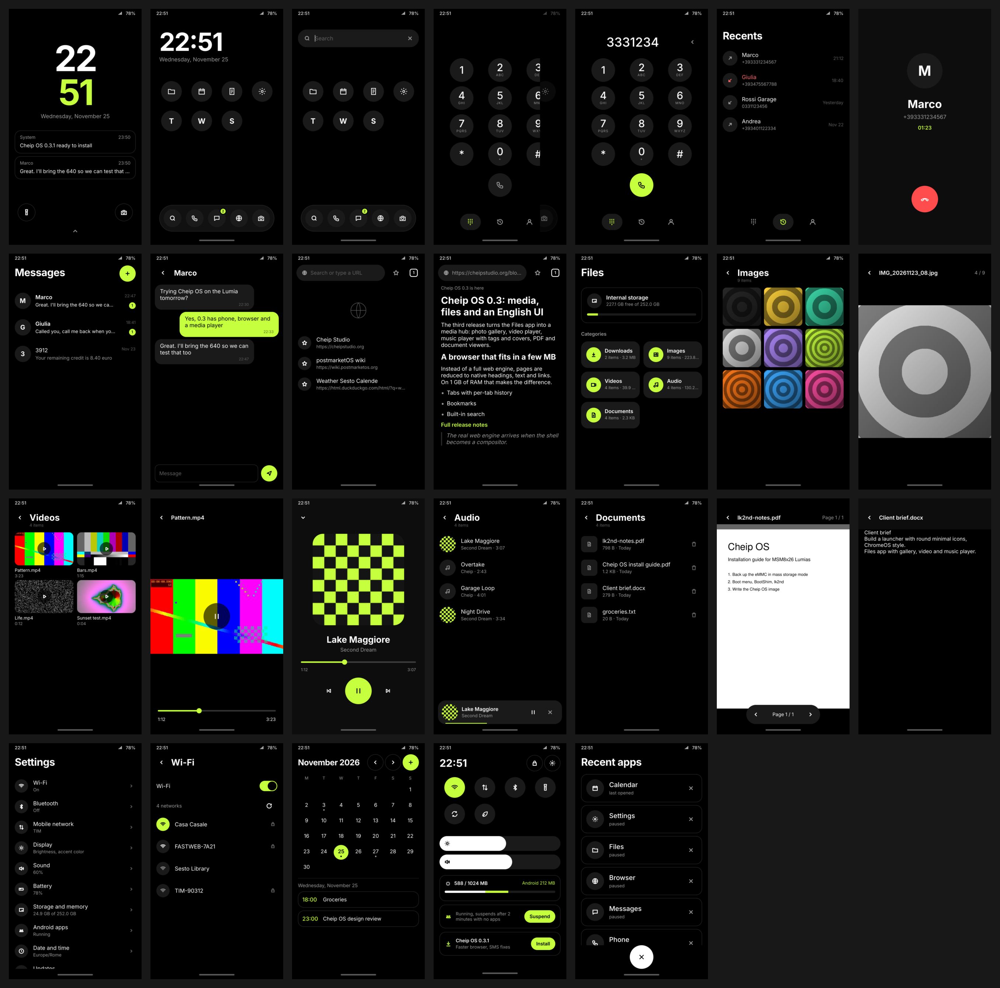

# Cheip OS

Sistema operativo leggero per i Lumia con Snapdragon 400 e 1 GB di RAM:
**Lumia 630, 640, 640 XL, 735, 830**. Base postmarketOS con kernel mainline,
shell propria in Rust + Slint, aggiornamenti OTA firmati.



## Stato 0.3

Interfaccia in inglese. Tutto quello che segue è verificato con i test e gli screenshot sul PC, mai su un telefono.

| Parte | Stato |
|---|---|
| Launcher stile ChromeOS | griglia di icone tonde senza testo, dock con ricerca, pallini di notifica |
| Shell | lock, quick settings a icone, recent apps, apertura app che si espande dall'icona |
| Phone, Messages | via ModemManager; il modem dei Lumia in mainline non è ancora attivo |
| Browser | modalità lettura: titoli, testo e link nativi, schede, preferiti, ricerca |
| Files | stile Google Files: categorie, galleria con visore, video player e music player (GStreamer), PDF (MuPDF), DOCX/ODT, TXT/MD/CSV, cartelle |
| Settings | Wi-Fi, Bluetooth, rete mobile, display, suoni, batteria, archiviazione, Android, data e ora, aggiornamenti, info |
| Calendar, Notes, Camera | Camera senza driver dei sensori in mainline |
| Video | nessuna decodifica hardware sui Lumia in mainline: meglio restare fino al 480p |
| OTA | manifest + repository apk firmato su Cloudflare R2 |
| Immagine per il telefono | CI con pmbootstrap, **mai provata su hardware** |

## Sviluppo sul PC

```sh
cd shell
cargo run                      # finestra 360x640
cargo test --no-default-features --features screens --lib
cargo run --no-default-features --features screens --bin cheip-screens -- ../screens
```

L'ultimo comando renderizza tutte le schermate a 720x1280 in PNG, senza display.

## Struttura

```
shell/ui/          interfaccia Slint: screens, apps, phone, messages, browser, files, settings
shell/src/         controller e ctl_* (telefono, messaggi, web, file, impostazioni),
                   modem (mmcli), web (lettura), files, system, store, OTA
system/            avvio della sessione, servizio OpenRC, helper root, udev, doas
packaging/         APKBUILD di cheip-shell e del pacchetto UI postmarketos-ui-cheip
.github/workflows/ shell.yml (test + screenshot), release.yml (immagine + OTA)
```

## Prima configurazione (una volta)

1. Chiave di firma OTA: `scripts/gen-key.sh`, poi `gh secret set CHEIP_APK_KEY < cheip-os.rsa`
   e commit di `keys/cheip-os.rsa.pub`. La privata non va mai nel repo.
2. Bucket R2 servito su `updates.cheipstudio.org`, poi i secret
   `R2_BUCKET`, `R2_ACCOUNT_ID`, `R2_ACCESS_KEY_ID`, `R2_SECRET_ACCESS_KEY`.
   Senza questi la release si fa lo stesso, solo senza upload OTA.
3. Dominio diverso? Cambialo in `system/update.json` e
   `packaging/postmarketos-ui-cheip/postmarketos-ui-cheip.post-install`.

## Release

```sh
git tag -a v0.1.1 -m "Animazioni più rapide, fix calendario"
git push origin v0.1.1
```

Il messaggio del tag diventa la nota dell'aggiornamento mostrata sul telefono.
La CI produce l'immagine `.img.xz`, i pacchetti armv7, il repository firmato e
`manifest.json`. I telefoni lo vedono da Controlli o Impostazioni, tasto Controlla.

## Installazione sul telefono

Catena di avvio dei Lumia MSM8x26: WPInternals, menu di avvio nella partizione EFIESP,
BootShim, lk2nd, kernel mainline. Nessuno l'ha ancora provata con Cheip OS: il primo giro
serve a capire cosa si rompe.

1. **Backup completo** (obbligatorio). WPInternals, Manual mode, "Switch to Mass-Storage-mode",
   poi Win32 Disk Imager legge tutta la eMMC. Sui Lumia Spec A con eMMC Samsung il ripristino
   di un dump può bloccare il telefono per sempre: tienilo come ultima risorsa.
2. **Menu di avvio e BootShim**. In mass storage la partizione EFIESP è visibile dal PC: si
   abilita il menu di avvio di Windows Phone e si aggiunge una voce che avvia BootShim, che a
   sua volta carica lk2nd. Comandi esatti: pagina "Windows Phone" del wiki postmarketOS.
3. **lk2nd** target `lk2nd-msm8226` (copre MSM8226 e MSM8926). Da verificare se serve un
   device tree del 735 dentro lk2nd: è il punto più incerto della catena.
4. **Cheip OS su microSD**: scrivi `cheip-os-*.img.xz` della release sulla scheda (Etcher o
   `xz -dc file.img.xz | dd of=/dev/sdX bs=4M`). Windows resta sulla memoria interna.
5. **Primo avvio**: dal menu scegli la voce lk2nd. Se la shell non parte, collega il telefono
   via USB: postmarketOS espone una rete USB (`ssh cheip@172.16.42.1`, password scelta in CI).

Consiglio: prima di Cheip OS prova postmarketOS standard sul 640 (`microsoft-dempsey` è nei
repository ufficiali). Se lì vedi schermo e touch, la catena funziona e i problemi restanti
sono nostri.

## Prossime milestone

- **0.4** la shell diventa compositor Wayland (Smithay): finestre Android via Waydroid
  con la stessa animazione di apertura delle app di sistema, e browser con motore WPE WebKit.
- **0.5** GPU: Adreno 305 con freedreno, display MDP5/DSI e driver pannello per modello.
  È il passo che porta ai 60 fps fissi.
- **0.6** OTA A/B con RAUC: sistema in sola lettura, rollback automatico se il boot fallisce.
- Fotocamera con libcamera, solo se arrivano driver per i sensori.

## Licenze

Codice GPL-3.0-or-later. Font Inter e Space Grotesk sotto SIL Open Font License 1.1.
